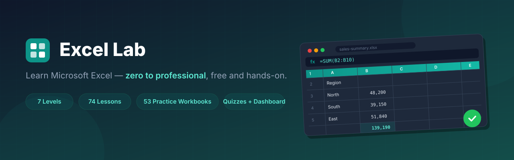

<div align="center">



# Excel Lab

**A complete, free Excel learning platform — 7 levels, 74 lessons, real workbooks, real office projects.**
From your first cell to Power Query, dashboards and VBA.

[](https://akhil-tg.github.io/Excel/)
[]()
[]()
[]()
[]()

</div>

---

## ✨ What's inside

- 📚 **7 structured levels, 74 lessons** — a full curriculum from spreadsheet basics to VBA automation
- 📊 **Real Excel practice workbooks** — 53 generated `.xlsx` files, not toy CSVs
- ✅ **Quizzes with answers** — every single lesson includes a quiz
- 🗂️ **Practice data library** — 5 raw 100-row datasets for VLOOKUP / XLOOKUP practice
- 📈 **Progress dashboard** — track completed lessons locally (localStorage, no account needed)
- 🌗 **Light & dark mode** — respects your system preference
- 🔎 **Instant search** — find any lesson from the header
- ♿ **Accessible** — semantic HTML, skip links, keyboard-friendly navigation

## 🗺️ Curriculum

| Level | Title | What you learn |
|:---:|---|---|
| 1 | Excel Fundamentals | Interface, cells, data entry, formatting, first formulas, references |
| 2 | Formulas and Functions | SUM, IF, VLOOKUP, XLOOKUP, INDEX-MATCH, text functions |
| 3 | Data Management | Sort, filter, Excel Tables, validation, conditional formatting, cleaning |
| 4 | Data Analysis and Reporting | Charts, PivotTables, slicers, KPI reporting, dashboard design |
| 5 | Real-World Office Applications | HR, payroll, inventory, sales, billing — the way offices actually work |
| 6 | Advanced Excel | Power Query, Power Pivot, DAX, macros and VBA |
| 7 | Practical Projects | **10 complete office systems** you build step by step — payroll, inventory, invoices, dashboards, MIS |

## 🚀 Quick start

No dependencies, no build step — it's plain HTML/CSS/JS:

```bash
git clone https://github.com/akhil-tg/Excel.git
cd Excel

# open index.html directly, or serve it:
python -m http.server 8000
```

Then visit `http://localhost:8000` — or just **[open the live site](https://akhil-tg.github.io/Excel/)**.

## 🛠️ Regenerating the practice workbooks

The `.xlsx` files in `assets/files/` are generated by Python scripts (one per level):

```bash
python scripts/gen_level1.py        # regenerate a level's workbooks
python scripts/gen_practice_data.py # regenerate the practice datasets
```

## 📁 Project structure

```
Excel/
├── index.html            # Homepage with hero + live stats
├── lessons.html          # Full curriculum browser
├── lesson.html           # Lesson viewer (?id=l1-what-is-excel)
├── dashboard.html        # Progress tracking dashboard
├── reference.html        # Function quick reference
├── practice-data.html    # Practice datasets page
├── docs.html             # Guides
├── assets/
│   ├── css/              # Site styling (design tokens, dark mode)
│   ├── js/               # App logic, lesson renderer, search
│   └── files/            # Generated .xlsx workbooks (levels 1–7 + practice data)
├── scripts/              # Python workbook generators (one per level)
└── docs/                 # Lesson schema + contributor docs
```

## 🤝 Contributing

Found a typo, a broken formula, or an unclear lesson? Issues and PRs are welcome —
lesson content follows the schema in [`docs/lesson-schema.md`](docs/lesson-schema.md).

## 📄 Usage

The course is **free to learn from** — use it for your own Excel journey and share the link.
Course content and workbooks may not be republished or resold without permission.

---

<div align="center">

**Built by Akhil TG**

</div>
